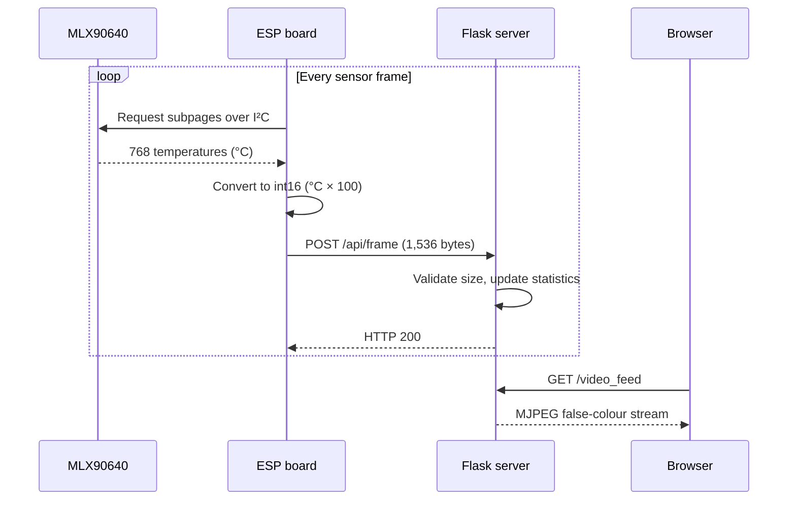
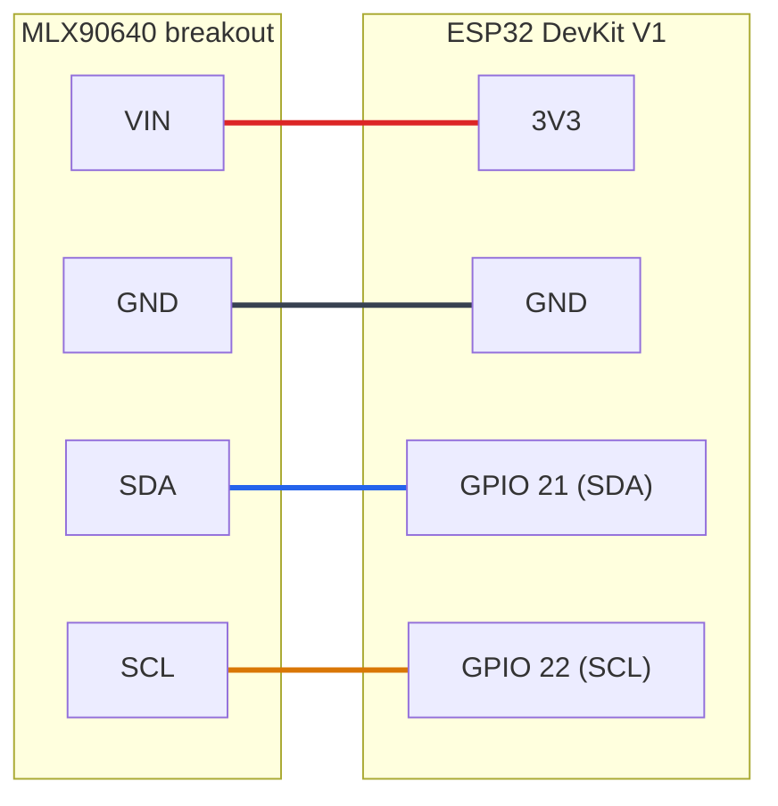
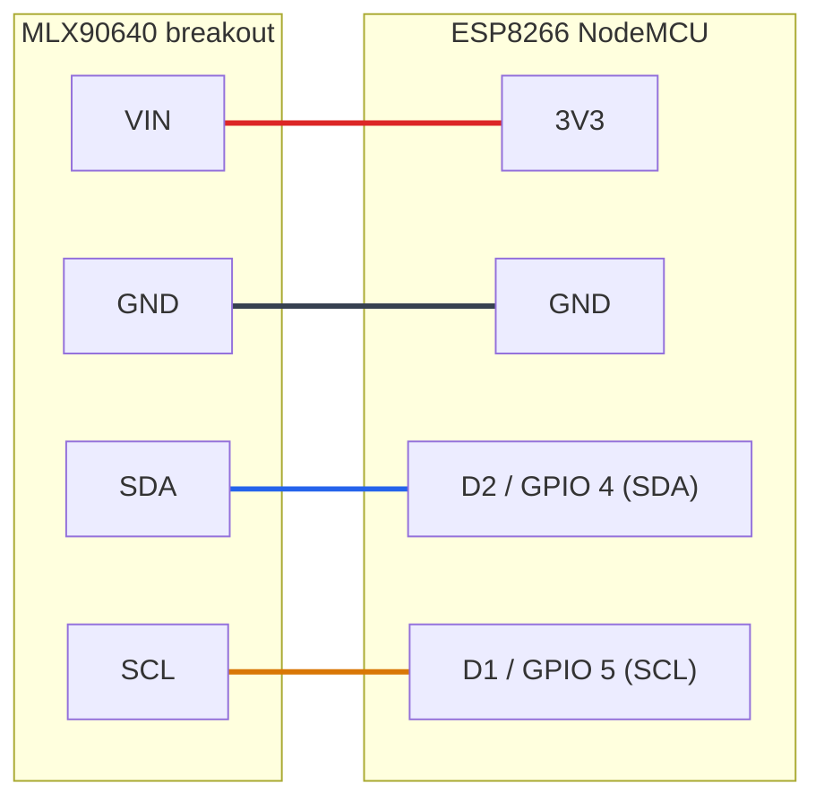
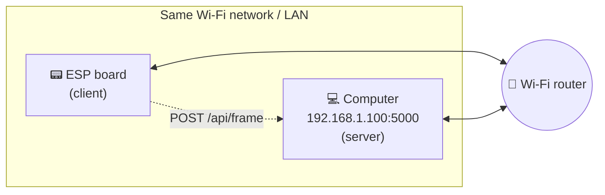

<div align="center">

# 🌡️ IR Thermal Vision

**Live MLX90640 thermal imaging over Wi-Fi: ESP32 / ESP8266 → Python → your browser**


*An ESP board reads 32 × 24 temperature frames from an MLX90640 sensor, sends them over Wi-Fi, and a Python server turns them into a false-colour MJPEG stream with live temperature readouts.*

</div>

---

> [!WARNING]
> **This project requires an MLX90640 thermal array.**
> The MLX90614 / DFRobot SEN0206 is a *single-point* infrared thermometer and **cannot** produce a thermal image. Do not buy the SEN0206 for this project.

## 📑 Table of Contents

- [Features](#-features)
- [How It Works](#-how-it-works)
- [Hardware](#-hardware)
- [Wiring Diagram](#-wiring-diagram)
- [Repository Structure](#-repository-structure)
- [Setup](#-setup)
  - [1. Install Arduino IDE and libraries](#1-install-arduino-ide-and-libraries)
  - [2. Start the dashboard](#2-start-the-computer-dashboard-first)
  - [3. Configure and upload firmware](#3-configure-and-upload-the-firmware)
  - [4. View the live stream](#4-view-the-live-thermal-stream)
- [Data Protocol](#-data-protocol)
- [Limitations](#-important-limitations)
- [Troubleshooting](#-troubleshooting)
- [Publishing to GitHub](#-publishing-to-github)
- [License](#-license)
- [References](#-references)

---

## ✨ Features

| | |
|---|---|
| 🎨 **Live false-colour stream** | Browser-based thermal view, no OLED required |
| 🔀 **ESP32 + ESP8266** | One Arduino sketch, selected at compile time |
| 📡 **Compact Wi-Fi protocol** | Fixed 1,536-byte binary frames over HTTP |
| 📊 **Live statistics** | Minimum, average and maximum temperature |
| 🎯 **Hottest-pixel crosshair** | Plus a stale-connection indicator |
| 🔒 **Fully local** | No cloud service or API key required |

---

## 🔄 How It Works

### System architecture

```mermaid
flowchart LR
    A["🌡️ MLX90640<br/>32 × 24 thermal array"] -- "I²C (0x33)" --> B["📟 ESP32 / ESP8266<br/>Reads frames"]
    B -- "Wi-Fi · HTTP POST<br/>1,536-byte frame" --> C["🐍 Flask server<br/>/api/frame"]
    C --> D["🖼️ OpenCV<br/>Interpolate + colour map"]
    D -- "MJPEG /video_feed" --> E["🌐 Browser dashboard<br/>127.0.0.1:5000"]

    style A fill:#fde68a,stroke:#b45309,color:#000
    style B fill:#bfdbfe,stroke:#1d4ed8,color:#000
    style C fill:#bbf7d0,stroke:#15803d,color:#000
    style D fill:#e9d5ff,stroke:#7e22ce,color:#000
    style E fill:#fecaca,stroke:#b91c1c,color:#000
```



### Frame lifecycle



---

## 🧰 Hardware

| # | Component | Notes |
|---|---|---|
| 1 | **ESP32 DevKit V1** *(recommended)* or ESP8266 NodeMCU | ESP8266 is experimental and slower |
| 2 | **MLX90640** 32 × 24 thermal camera breakout | I²C, address normally `0x33` |
| 3 | USB cable and a computer | Windows, Linux or macOS |
| 4 | Jumper wires | Keep them short |

No OLED, display, buzzer or separate camera is required.

---

## 🔌 Wiring Diagram

> [!CAUTION]
> Use **3.3 V logic** with ESP boards. Never connect a 5 V I²C signal to an ESP GPIO. Power the breakout according to its own documentation; if it has a `VIN` pin with an onboard regulator, follow its specified input range.

### ESP32 DevKit V1 (recommended)



```text
   MLX90640 breakout                ESP32 DevKit V1
  ┌─────────────────┐              ┌──────────────────┐
  │  VIN / 3V3  ●───┼── red ───────┼───● 3V3          │
  │  GND        ●───┼── black ─────┼───● GND          │
  │  SDA        ●───┼── blue ──────┼───● GPIO 21      │
  │  SCL        ●───┼── yellow ────┼───● GPIO 22      │
  └─────────────────┘              └──────────────────┘
```

### ESP8266 NodeMCU (experimental)



```text
   MLX90640 breakout                ESP8266 NodeMCU
  ┌─────────────────┐              ┌──────────────────┐
  │  VIN / 3V3  ●───┼── red ───────┼───● 3V3          │
  │  GND        ●───┼── black ─────┼───● GND          │
  │  SDA        ●───┼── blue ──────┼───● D2 (GPIO 4)  │
  │  SCL        ●───┼── yellow ────┼───● D1 (GPIO 5)  │
  └─────────────────┘              └──────────────────┘
```

### Pin reference

| MLX90640 breakout | Wire colour (suggested) | ESP32 DevKit V1 | ESP8266 NodeMCU |
|---|---|---|---|
| VIN / 3V3 | 🔴 Red | 3V3 *(or breakout-specified VIN)* | 3V3 *(or breakout-specified VIN)* |
| GND | ⚫ Black | GND | GND |
| SDA | 🔵 Blue | GPIO 21 | D2 / GPIO 4 |
| SCL | 🟡 Yellow | GPIO 22 | D1 / GPIO 5 |

> [!TIP]
> Keep I²C wires short. If the sensor is not detected, check the breakout's power requirements, SDA/SCL orientation, common ground and I²C pull-ups. The firmware expects address `0x33`.

### Network layout



Both devices must be on the same LAN. Guest Wi-Fi / client isolation can block device-to-device traffic.

---

## 📁 Repository Structure

```text
ir-thermal-vision/
├── firmware/
│   └── IR_Thermal_Vision/
│       └── IR_Thermal_Vision.ino
├── desktop/
│   ├── app.py
│   ├── requirements.txt
│   └── templates/
│       └── index.html
├── .gitignore
├── LICENSE
└── README.md
```

---

## 🚀 Setup

### 1. Install Arduino IDE and libraries

1. Install **Arduino IDE 2.x**.
2. Open **Library Manager** and install:
   - `Adafruit MLX90640`
   - `Adafruit BusIO` *(usually installed as a dependency)*
3. **ESP32:** install **esp32 by Espressif Systems** in Boards Manager.
4. **ESP8266:** add this URL under *Preferences → Additional Boards Manager URLs*:

   ```text
   https://arduino.esp8266.com/stable/package_esp8266com_index.json
   ```

   Then install **esp8266 by ESP8266 Community** in Boards Manager.

### 2. Start the computer dashboard first

Install **Python 3.10 or newer**, then open a terminal in the `desktop` folder.

<details open>
<summary><b>🪟 Windows (PowerShell)</b></summary>

```powershell
py -m venv .venv
.venv\Scripts\Activate.ps1
python -m pip install --upgrade pip
pip install -r requirements.txt
python app.py
```

If PowerShell blocks activation, run this once in the current terminal:

```powershell
Set-ExecutionPolicy -Scope Process -ExecutionPolicy Bypass
.venv\Scripts\Activate.ps1
```

</details>

<details>
<summary><b>🐧 Linux / 🍎 macOS</b></summary>

```bash
python3 -m venv .venv
source .venv/bin/activate
python -m pip install --upgrade pip
pip install -r requirements.txt
python app.py
```

</details>

The server listens on port `5000`. **Keep this terminal open.**

#### Find your computer's local IPv4 address

| OS | Command |
|---|---|
| Windows | `ipconfig` → *IPv4 Address* under the Wi-Fi adapter (e.g. `192.168.1.100`) |
| Linux | `hostname -I` |
| macOS | `ipconfig getifaddr en0` (typical Wi-Fi setup) |

Open the dashboard on your computer at **<http://127.0.0.1:5000>**.

> [!NOTE]
> If the ESP cannot reach the server, allow Python on **private networks** in Windows Firewall.

### 3. Configure and upload the firmware

Open `firmware/IR_Thermal_Vision/IR_Thermal_Vision.ino` and edit the three settings near the top:

```cpp
const char* WIFI_SSID     = "YOUR_WIFI_NAME";
const char* WIFI_PASSWORD = "YOUR_WIFI_PASSWORD";
const char* FRAME_URL     = "http://192.168.1.100:5000/api/frame";
```

Replace the Wi-Fi name, password and example IP with your own values.

> [!IMPORTANT]
> Never commit real Wi-Fi credentials to a public repository. Use placeholders before pushing.

<details open>
<summary><b>Upload to ESP32 DevKit V1 (recommended)</b></summary>

1. Connect the ESP32 by USB.
2. Select **Tools → Board → ESP32 Arduino → ESP32 Dev Module** (or your exact DevKit board).
3. Select the correct COM port.
4. Click **Upload**.
5. Open Serial Monitor at `115200` baud.

Pin mapping: SDA `GPIO 21`, SCL `GPIO 22`. Sensor refresh is set to `4` pages/second (about 2 complete frames/second, since an MLX90640 frame has two subpages).

</details>

<details>
<summary><b>Upload to ESP8266 NodeMCU (experimental / slower)</b></summary>

1. Connect the NodeMCU by USB.
2. Select **Tools → Board → ESP8266 Boards → NodeMCU 1.0 (ESP-12E Module)**.
3. Select the correct COM port and upload.
4. Open Serial Monitor at `115200` baud.

Pin mapping: SDA `D2/GPIO4`, SCL `D1/GPIO5`. The firmware uses a lower refresh rate to reduce load. If the library fails to initialise or the board resets from memory pressure, use the ESP32 DevKit V1 instead.

</details>

### 4. View the live thermal stream

With the Python server running and the firmware uploaded:

1. Open the Serial Monitor and wait for `Wi-Fi connected` and `MLX90640 initialized`.
2. Confirm the ESP prints its IP address.
3. Open <http://127.0.0.1:5000> in your browser.
4. The dashboard changes from **WAITING FOR SENSOR** to **THERMAL SENSOR CONNECTED** after the first valid frame.

| Endpoint | Purpose |
|---|---|
| `http://127.0.0.1:5000/` | Dashboard |
| `http://127.0.0.1:5000/video_feed` | Raw thermal MJPEG stream |
| `http://127.0.0.1:5000/health` | Server health |
| `POST /api/frame` | Frame upload from the ESP |

---

## 📦 Data Protocol

The ESP sends an HTTP `POST` to `/api/frame` with `Content-Type: application/octet-stream`.

```text
┌───────────────────────────────────────────────────────────────┐
│ Body: exactly 1,536 bytes = 768 pixels × 2 bytes              │
├───────────────────────────────────────────────────────────────┤
│ Pixel 0 │ Pixel 1 │ Pixel 2 │  ...  │ Pixel 767               │
│ int16 LE│ int16 LE│ int16 LE│       │ int16 LE                │
└───────────────────────────────────────────────────────────────┘
 Value = temperature in °C × 100       (example: 3650 → 36.50 °C)
 -32768 = reserved for an invalid pixel
 Layout: 32 columns × 24 rows
```

The server checks the payload size before accepting it.

---

## ⚠️ Important Limitations

- **Resolution:** The MLX90640 is only **32 × 24 pixels**. The dashboard enlarges the image with interpolation; it does not create extra thermal detail.
- **ESP8266:** Less RAM and processing headroom. Its firmware uses a slower refresh rate and may be unreliable on some boards. ESP32 is recommended.
- **No person detection:** The crosshair marks the hottest pixel only. This starter project does **not** identify people or provide reliable human detection / bounding boxes.
- **Frame rate:** The stream is made from successive sensor frames, not an RGB video feed. Sensor refresh rate and I²C speed limit the frame rate.
- **Accuracy:** Readings depend on calibration, emissivity, distance, field of view and target surface. **Not a certified medical or safety instrument.**

---

## 🛠️ Troubleshooting

| Symptom | Checks |
|---|---|
| `MLX90640 not found` | Confirm the part is an MLX90640 (not MLX90614), I²C wiring, power, common GND and address `0x33`. |
| Wi-Fi connects but no frames arrive | Check `FRAME_URL` uses the computer's LAN IP and port `5000`, same Wi-Fi, firewall permissions. Never use `localhost` in firmware. |
| Dashboard says *waiting for sensor* | Check the Serial Monitor for HTTP errors; open `/health` on the computer. |
| `HTTP code: -1` | Server unreachable: wrong IP/port, firewall, or Wi-Fi client isolation. |
| Unstable frames / I²C errors | Shorten wires, check power and pull-ups, try the ESP32, keep the refresh rate low. |
| Image looks blocky | Expected: only 32 × 24 pixels. Upscaling smooths the display but cannot add detail. |
| ESP8266 resets or fails to compile | Use the ESP32 DevKit V1; ESP8266 support is best-effort due to memory/CPU limits. |

---

## 📤 Publishing to GitHub

From the project root:

```bash
git init
git add .
git commit -m "Initial IR Thermal Vision project"
git branch -M main
git remote add origin https://github.com/YOUR-USERNAME/ir-thermal-vision.git
git push -u origin main
```

Create an empty repository on GitHub first and replace `YOUR-USERNAME` with your username. Do not upload Wi-Fi passwords, personal network details, virtual environments or compiled build files.

---

## 📄 License

Released under the **MIT License**. See [LICENSE](LICENSE).

## 🔗 References

- [Adafruit MLX90640 Arduino library](https://github.com/adafruit/Adafruit_MLX90640)
- [Adafruit MLX90640 API reference](https://adafruit.github.io/Adafruit_MLX90640/html/class_adafruit___m_l_x90640.html)
- [ESP8266 Arduino core](https://github.com/esp8266/Arduino)

---

<div align="center">

⭐ If this project helped you, consider giving the repository a star.

</div>
